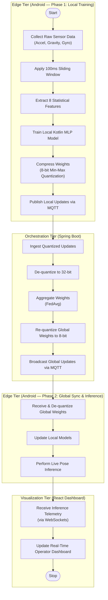
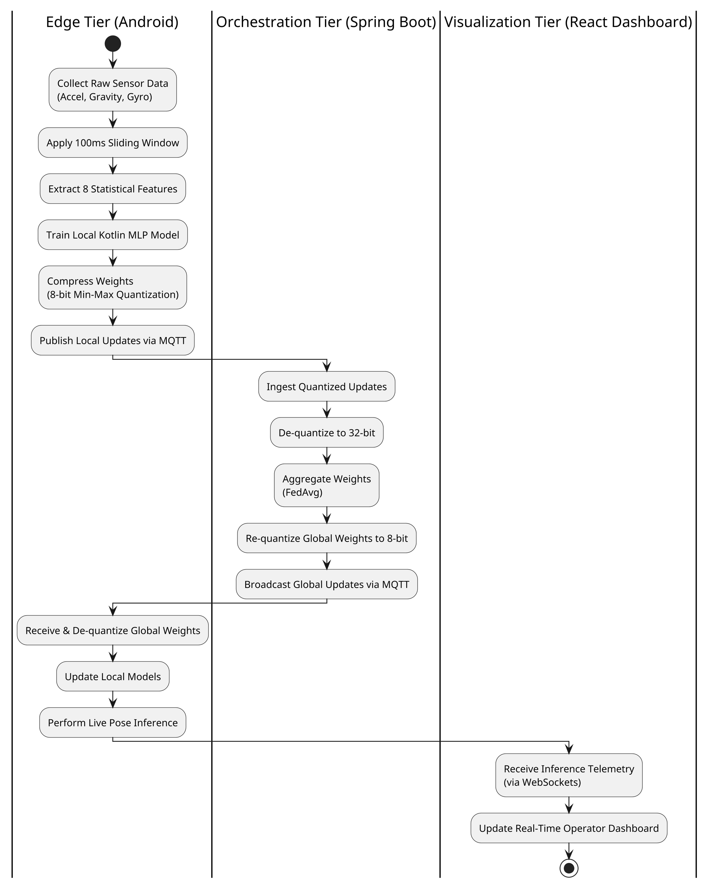

# CSC 8223 — Federated Learning with Smartphone Sensors (`CSC8223_IoT`)

> **Core Research Question**: *"Can smart devices with different (non-IID) local sensor data collaboratively learn a global model that performs better than any device can learn alone?"*

This repository implements an end-to-end, privacy-preserving **Federated Learning (FL)** system for **6-Pose Smartphone Spatial Orientation Classification** across three integrated projects:

1. **[`PROJECT_ANDROID`](./PROJECT_ANDROID)** — **Edge Tier (Native Kotlin & Jetpack Compose Android App)**: Samples onboard MEMS sensors, extracts normalized gravity features over a 100 ms sliding window, trains an on-device Multi-Layer Perceptron (`8 → 16 → 6`), compresses model updates via 8-bit symmetric min-max quantization, and streams live pose telemetry over MQTT.
2. **[`PROJECT_BACKEND`](./PROJECT_BACKEND)** — **Orchestration Tier (Java 21 Spring Boot + Eclipse Mosquitto MQTT + PostgreSQL)**: Ingests 8-bit quantized local weight updates over MQTT, de-quantizes and aggregates them using **Federated Averaging (FedAvg)**, persists model snapshots in PostgreSQL, broadcasts synchronized global weights back to the phones, and bridges live inference telemetry to WebSockets (`/ws/telemetry`).
3. **[`PROJECT_DASHBOARD`](./PROJECT_DASHBOARD)** — **Visualization & Control Tier (React 19 + TypeScript + Vite + Tailwind CSS v4)**: Real-time operator dashboard that visualizes live 3D spatial phone poses, dispatches remote MQTT experiment & model-switching commands (`START_TRAINING`, `SET_MODEL`, `RESET_ALL`), tracks FedAvg rounds, compares all three required models via $6 \times 6$ confusion matrices and Macro-F1 scores, and evaluates the **74.59% MQTT payload reduction** achieved by 8-bit weight quantization.

---

## System Architecture & End-to-End Workflow Diagram




<details>
<summary><strong>View PlantUML Source (<code>@startuml ... @enduml</code>)</strong></summary>


</details>

---

## Repository Directory Structure

```text
CSC8223_IoT/
├── PROJECT_ANDROID/      # (1) Edge Tier: Android Kotlin sensor, MLP & MQTT client app
├── PROJECT_BACKEND/      # (2) Orchestration Tier: Spring Boot FedAvg, MQTT & WebSocket server
├── PROJECT_DASHBOARD/    # (3) Visualization Tier: React 19 + TypeScript + Tailwind v4 dashboard
└── README.md             # Root multi-project documentation
```

---

## Detailed Project Breakdown

### 1. `PROJECT_ANDROID` — Edge Tier (Android IoT Client)

Native Android application written in **Kotlin** with **Jetpack Compose** (`minSdk = 26`, `targetSdk = 34`) that collects sensor data, trains an on-device neural network, and participates in federated learning without ever transmitting raw sensor readings.

- **Key Components**:
  - [`SensorService.kt`](./PROJECT_ANDROID/app/src/main/java/com/gsu/iot/pose/SensorService.kt): Foreground service that continuously samples `Sensor.TYPE_GRAVITY` (falling back to `Sensor.TYPE_ACCELEROMETER`) and `Sensor.TYPE_GYROSCOPE` at `SENSOR_DELAY_FASTEST` with locked portrait screen orientation so physical rotation does not interrupt training or inference.
  - [`FeatureExtractor.kt`](./PROJECT_ANDROID/app/src/main/java/com/gsu/iot/pose/FeatureExtractor.kt): Buffers 3-axis gravity readings over a **100 ms sliding window** and computes **8 normalized statistical features** ($\mu_x, \mu_y, \mu_z, \sigma_x, \sigma_y, \sigma_z, \mu_{\|\mathbf{g}\|}, \sigma_{\|\mathbf{g}\|}$ divided by $9.8\text{ m/s}^2$ into $[-1, 1]$).
  - [`MultiLayerPerceptron.kt`](./PROJECT_ANDROID/app/src/main/java/com/gsu/iot/pose/mlp/MultiLayerPerceptron.kt): Lightweight on-device MLP (`8` inputs $\rightarrow$ `16` Sigmoid hidden units $\rightarrow$ `6` Softmax output classes, $\eta = 0.1$) comprising exactly **246 trainable floating-point parameters** (`W1: 128`, `b1: 16`, `W2: 96`, `b2: 6`).
  - [`ModelManager.kt`](./PROJECT_ANDROID/app/src/main/java/com/gsu/iot/pose/mlp/ModelManager.kt): Maintains two independent models in memory (`localModel` for isolated baseline evaluation and `federatedModel` for collaborative FedAvg inference) and switches active inference on demand.
  - [`Quantizer.kt`](./PROJECT_ANDROID/app/src/main/java/com/gsu/iot/pose/federated/Quantizer.kt): Implements symmetric min-max 8-bit quantization (`FloatArray(246)` $\leftrightarrow$ `ByteArray(250)` with a 4-byte Big-Endian `maxAbs` float header).
  - [`MqttClientManager.kt`](./PROJECT_ANDROID/app/src/main/java/com/gsu/iot/pose/federated/MqttClientManager.kt): Eclipse Paho MQTT client publishing quantized local weights to `federated/local/weights/{clientId}` and live pose telemetry to `federated/telemetry/{clientId}`, while subscribing to `federated/global/weights`, `federated/commands`, and per-client local weight reload topics.
  - [`MainActivity.kt`](./PROJECT_ANDROID/app/src/main/java/com/gsu/iot/pose/ui/MainActivity.kt): Provides three interactive modes:
    1. **Inference Mode**: Live pose classification with instant `LOCAL` vs. `GLOBAL` model toggling.
    2. **Training Mode**: Guided 3-second audio-beep countdown and 50-sample-per-pose recording loop that publishes quantized weight updates every 10 samples and trains 20 local epochs upon completion.
    3. **Eval / Calib Mode**: Records a universal 6-pose evaluation dataset (10 samples per pose = 60 samples) and benchmarks **Local Model Accuracy** vs. **Global Model Accuracy** directly on the phone.

---

### 2. `PROJECT_BACKEND` — Orchestration Tier (Spring Boot Server)

Java 21 + **Spring Boot 4** server integrating **Spring Integration MQTT**, **Spring WebSockets**, and **Spring Data JPA (PostgreSQL)** to orchestrate Federated Averaging (`FedAvg`) and bridge live telemetry to the web dashboard.

- **Key Components**:
  - [`MqttIntegrationConfig.java`](./PROJECT_BACKEND/src/main/java/com/samuel_robles/java_backend/config/MqttIntegrationConfig.java): Configures inbound and outbound MQTT adapters connected to Eclipse Mosquitto (`tcp://localhost:1883`). Routes binary payloads on `federated/local/weights/#` to `FederatedAggregationService` and JSON payloads on `federated/telemetry/#` to `TelemetryWebSocketHandler`.
  - [`FederatedAggregationService.java`](./PROJECT_BACKEND/src/main/java/com/samuel_robles/java_backend/federated/FederatedAggregationService.java): Buffers decoded client weight updates until `expectedClients` (`2`) have reported in the current round, computes the element-wise **FedAvg** mean across all 246 parameters, persists `GLOBAL` and per-client `LOCAL` snapshots to PostgreSQL, and publishes the re-quantized global model (`250 bytes`, retained) to `federated/global/weights`.
  - [`QuantizedWeightsCodec.java`](./PROJECT_BACKEND/src/main/java/com/samuel_robles/java_backend/federated/QuantizedWeightsCodec.java): Server-side codec matching Android's `Quantizer.kt` wire format (`decode(byte[])` $\rightarrow$ `float[]` and `encode(float[])` $\rightarrow$ `byte[]`).
  - [`TelemetryWebSocketHandler.java`](./PROJECT_BACKEND/src/main/java/com/samuel_robles/java_backend/websocket/TelemetryWebSocketHandler.java) & [`WebSocketConfig.java`](./PROJECT_BACKEND/src/main/java/com/samuel_robles/java_backend/config/WebSocketConfig.java): Broadcasts real-time pose telemetry to connected dashboard clients at `ws://localhost:8080/ws/telemetry`.
  - [`MqttController.java`](./PROJECT_BACKEND/src/main/java/com/samuel_robles/java_backend/controller/MqttController.java): Exposes REST endpoints under `/api/mqtt`:
    - `GET /api/mqtt/federated/status` — Live FedAvg round statistics (`receivedUpdates`, `completedRounds`, `pendingUpdates`, `expectedClients`, `globalWeightCount`, `lastAggregationAt`).
    - `GET /api/mqtt/latest` — Latest MQTT message inspected by `MqttMessageStore`.
    - `POST /api/mqtt/federated/training` — Publishes `{"command":"START_TRAINING","use_quantization":true|false}` to `federated/commands`.
    - `POST /api/mqtt/federated/model/toggle` — Publishes `{"command":"SET_MODEL","active_model":"LOCAL"|"GLOBAL"}` to `federated/commands`.
    - `POST /api/mqtt/federated/model/republish` & `/republish-all` — Republishes persisted global and/or local model weights from PostgreSQL to MQTT.
    - `POST /api/mqtt/federated/command` — Dispatches custom control commands (`RESET_GLOBAL`, `RESET_ALL`, etc.).

---

### 3. `PROJECT_DASHBOARD` — Visualization & Control Tier (React Dashboard)

Modern web dashboard built with **React 19**, **TypeScript**, **Vite**, and **Tailwind CSS v4** that provides real-time monitoring, remote experiment orchestration, and quantitative model evaluation. (See [`PROJECT_DASHBOARD/README.md`](./PROJECT_DASHBOARD/README.md) for full internal documentation.)

- **Key Components**:
  - [`PhonePoseVisualizer.tsx`](./PROJECT_DASHBOARD/src/components/PhonePoseVisualizer.tsx): Renders live 3D-styled spatial orientation cards for **Client A** and **Client B**, gravity axis hints, non-IID **In-Distribution (50 samples)** vs. **Out-of-Distribution (0 samples — Needs GLOBAL Model)** badges, dynamic `EdgeClient_*` device ID binding, and an offline **Demo Pose Simulator**.
  - [`OrchestrationControlPanel.tsx`](./PROJECT_DASHBOARD/src/components/OrchestrationControlPanel.tsx): Remote control panel for initiating comparative training runs (`32-bit Baseline` vs. `8-bit Quantized`), toggling active inference models (`LOCAL` vs. `GLOBAL`), syncing server snapshots, resetting edge models, and monitoring live FedAvg round barriers.
  - [`ModelComparisonSection.tsx`](./PROJECT_DASHBOARD/src/components/ModelComparisonSection.tsx): Side-by-side comparison of **Client A Local Model**, **Client B Local Model**, and **Federated Global Model** across all 6 poses with **Overall Accuracy**, **Per-Class Recall & F1**, **Macro-F1 Score**, **$6 \times 6$ Confusion Matrices**, and a **Live Evaluation Capture** tool.
  - [`QuantizationContributionSection.tsx`](./PROJECT_DASHBOARD/src/components/QuantizationContributionSection.tsx): Evaluates the 8-bit symmetric min-max quantization contribution (`984 Bytes` $\rightarrow$ `250 Bytes` = **74.59% payload reduction** / **$3.94\times$ compression**), cumulative MQTT bandwidth savings, and per-weight quantization error.
  - [`SystemArchitecturePipeline.tsx`](./PROJECT_DASHBOARD/src/components/SystemArchitecturePipeline.tsx): Visualizes the 5-stage FL workflow, the Non-IID dataset split, on-device MLP hyperparameters, and Privacy Rule enforcement.

---

## Six-Pose Classification & Non-IID Data Design

To evaluate federated learning under an extreme **non-IID** data distribution, neither edge device observes all six poses during local training:

| Pose Class | Physical Definition | Client A Local Training | Client B Local Training | Universal Eval / Calibration |
| :--- | :--- | :---: | :---: | :---: |
| **Screen Up** | Phone lies flat with the screen facing upward. | **50 samples** | 0 *(unseen)* | 10 samples / phone |
| **Screen Down** | Phone lies flat with the screen facing downward. | **50 samples** | 0 *(unseen)* | 10 samples / phone |
| **Portrait Up** | Phone is vertical with the top edge pointing upward. | **50 samples** | 0 *(unseen)* | 10 samples / phone |
| **Portrait Down** | Phone is vertical with the top edge pointing downward. | 0 *(unseen)* | **50 samples** | 10 samples / phone |
| **Landscape Left** | Phone is vertical with the left edge pointing upward. | 0 *(unseen)* | **50 samples** | 10 samples / phone |
| **Landscape Right** | Phone is vertical with the right edge pointing upward. | 0 *(unseen)* | **50 samples** | 10 samples / phone |

---

## Quick Start: Building & Running the Complete System

### 1. Start MQTT Broker & PostgreSQL + Spring Boot Backend (`PROJECT_BACKEND`)
Ensure Eclipse Mosquitto (`tcp://localhost:1883`) and PostgreSQL (`localhost:5432/postgres`) are running, then start the Spring Boot server:

```powershell
cd PROJECT_BACKEND
.\mvnw.cmd spring-boot:run
```
The backend will listen on `http://localhost:8080` (REST API at `/api/mqtt/...` and WebSockets at `ws://localhost:8080/ws/telemetry`).

### 2. Start the React Operator Dashboard (`PROJECT_DASHBOARD`)
In a new terminal:

```powershell
cd PROJECT_DASHBOARD
npm install
npm run dev
```
Open **`http://localhost:5173`** in your browser.

### 3. Build & Install the Android Edge Client (`PROJECT_ANDROID`)
Open [`PROJECT_ANDROID`](./PROJECT_ANDROID) in **Android Studio** (or build via Gradle CLI) and install onto two Android phones:

```powershell
cd PROJECT_ANDROID
.\gradlew.bat assembleDebug
```
On each phone, enter the computer's LAN IP address in the **Broker IP** field and tap **Connect**.

